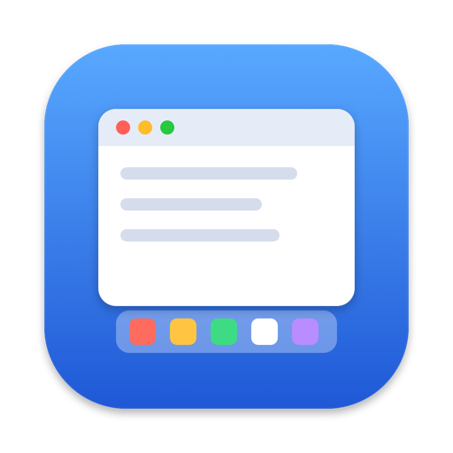

# DockSnug

Keeps your windows fitted around the Dock when it moves between monitors.

https://traes008.github.io/docksnug/

- Windows grow when the Dock leaves their screen and shrink when it arrives.
- Fixes the gap macOS sometimes leaves after full screen, by restarting the Dock.
- Brings the Dock over if macOS ignores your push against a screen edge.

## Install

1. [Download DockSnug.zip](https://traes008.github.io/docksnug/DockSnug.zip), unzip it and move the app to Applications.
2. Open it. macOS blocks it because it isn't signed by Apple: go to System Settings → Privacy & Security and click **Open Anyway**.
3. Allow it under Privacy & Security → Accessibility.

No menu bar icon. Open the app again for its settings.

Or build it yourself: open `DockSnug.xcodeproj` in Xcode, pick your own team under Signing & Capabilities, and run.

## Notes

- Only used with two displays and the Dock at the bottom.
- Needs "Displays have separate Spaces" on, which is the default.
- `scripts/check.sh` runs the logic tests. Start reading at `DockSnug/DockGeometry.swift`.

MIT licence.
